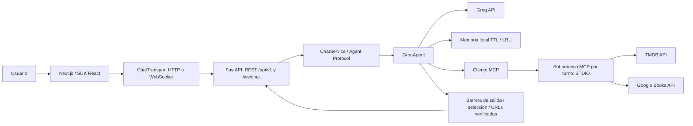
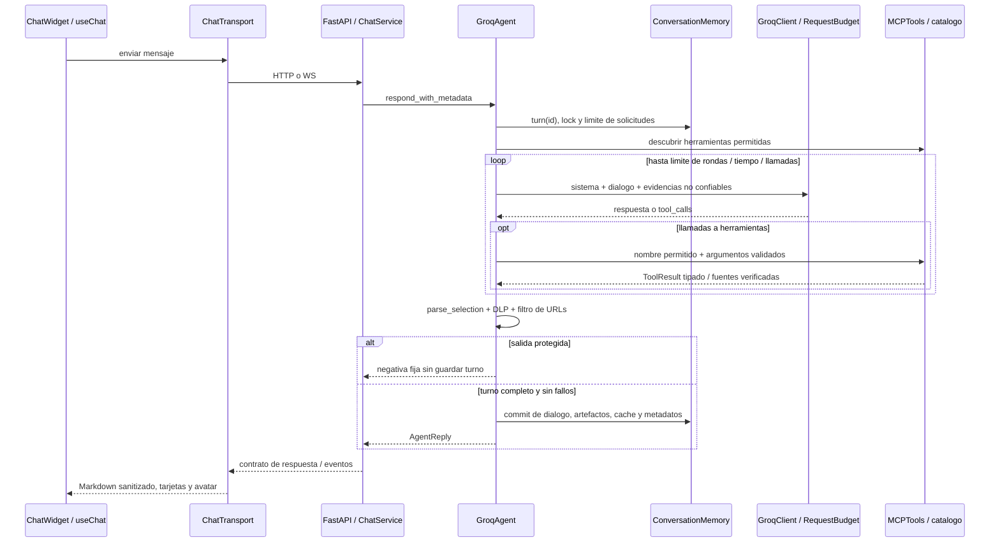

# Arquitectura de Damian: Proyecto 2

## HLD: sistema desplegado

Docker Compose ejecuta web y api; MCP se ejecuta como subproceso de api, no como un tercer servicio. Solo api recibe el archivo de credenciales. El navegador consume contratos de chat y metadatos; nunca ejecuta logica del agente. La demo usa HTTP; el SDK tambien ofrece WebSocket. WebSocket emite eventos de inicio, mensaje completo y fin: no es streaming de tokens.

## LLD: componentes y ejecucion

`context.py` proyecta evidencias acotadas y reutiliza consultas mediante claves normalizadas. `memory.py` conserva hasta seis turnos, 12 artefactos y 12 entradas de cache; capacidad predeterminada de 128 conversaciones y TTL de 900 segundos. Serializa turnos por conversacion. `GroqAgent` limita ocho turnos activos y ocho llamadas MCP, con concurrencia de herramientas de dos y consultas Books serializadas. `GroqClient` controla presupuestos y diagnosticos; los errores privados no llegan al widget.

Las seis herramientas permitidas son search_movies, discover_movies, movie_details, search_books, book_details y compare_movies. MCP valida nombre, esquema JSON y modelos Pydantic; no admite comandos o URLs arbitrarias. `presentation.py` deriva tarjetas de artefactos consultados; la interfaz no debe interpretar texto del modelo como acciones privilegiadas.

## Decisiones y escalabilidad

La interfaz Agent permite reemplazar proveedores sin alterar rutas. ChatTransport permite cambiar la comunicacion sin modificar componentes visuales. Los catalogos aportan fuentes verificables y los presupuestos acotan latencia, costo y carga.

El estado actual es de una instancia: memoria, locks, cache y limites son locales al proceso. Agregar replicas sin cambiar esto perderia continuidad y permitiria superar limites. Para escalar: introducir un almacenamiento compartido con TTL (por ejemplo Redis), locks distribuidos y limites globales por proveedor; separar cache de catalogo de memoria conversacional. Un balanceador debe soportar Upgrade de WebSocket y cierre ordenado de conexiones. Afinidad de sesion puede ser una transicion, pero no resuelve reinicios ni cuotas compartidas.

Separar MCP en un servicio persistente exige sustituir STDIO por un transporte autenticado y limitar su red a los catalogos. Mantener cuotas y backpressure antes de aumentar replicas; medir p95, errores 429, uso de tokens y saturacion. Redis, balanceador y MCP remoto son propuestas, no infraestructura implementada.

Los identificadores de conversacion no constituyen autenticacion. Un despliegue multiusuario requiere identidad autenticada y autorizacion del propietario antes de acceder a memoria. No almacenar secretos en prompts; la confidencialidad no puede depender de instrucciones al modelo.

Antes de ejecutar MCP, el agente inspecciona los argumentos de texto con la misma barrera de datos protegidos utilizada para la salida. Una coincidencia evita la llamada externa y marca el turno como fallido, sin persistirlo.
